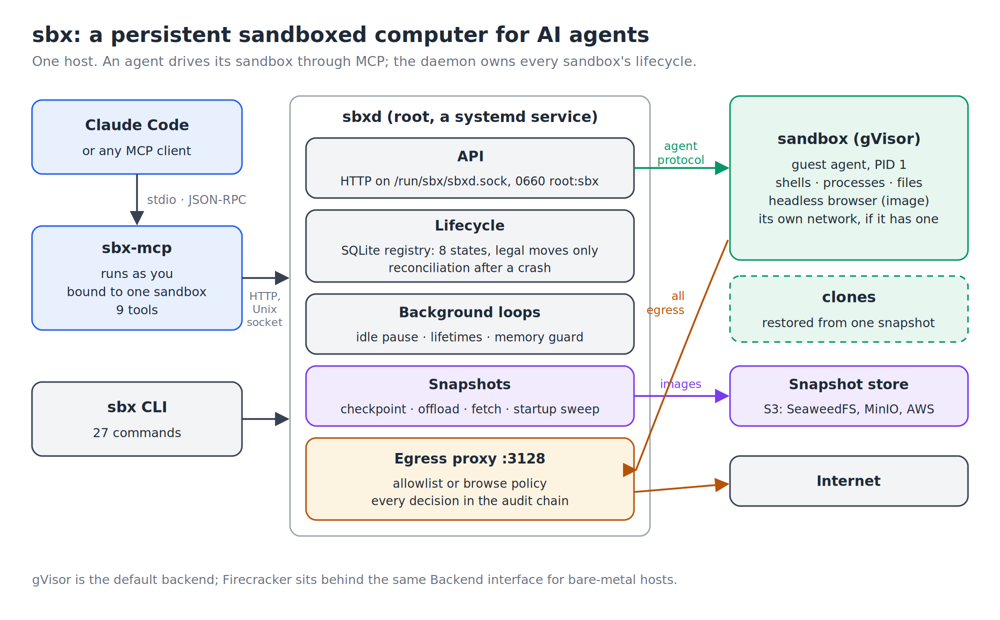
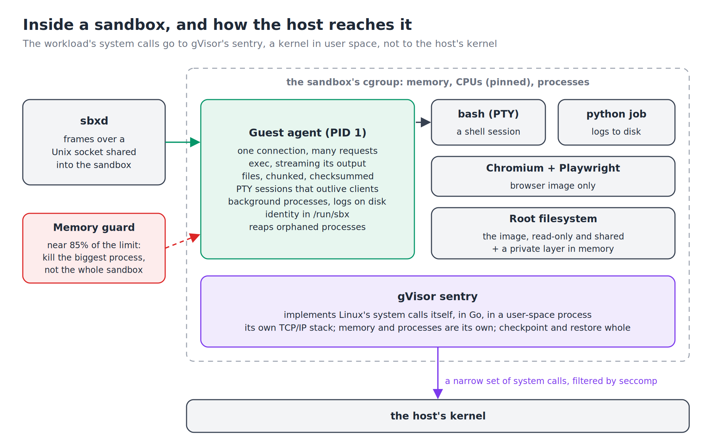
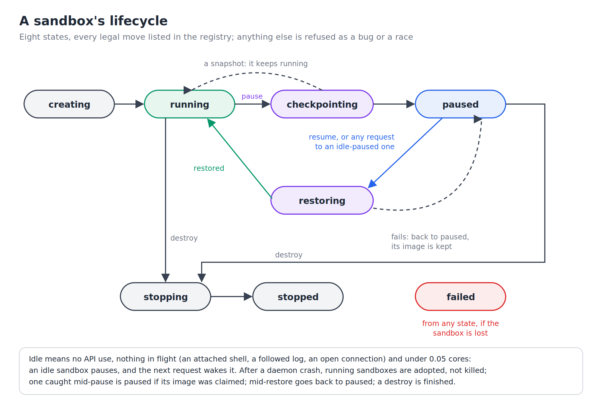
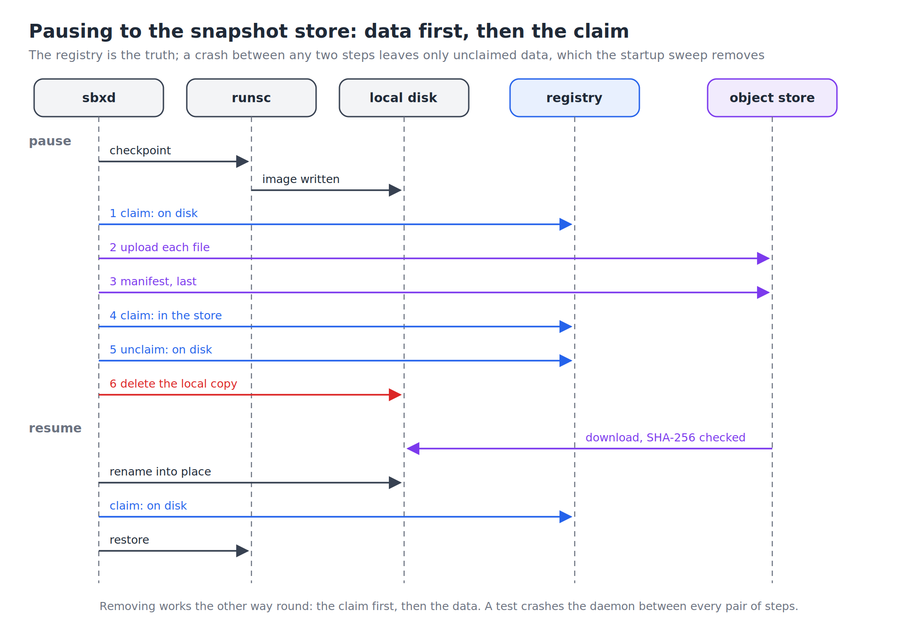
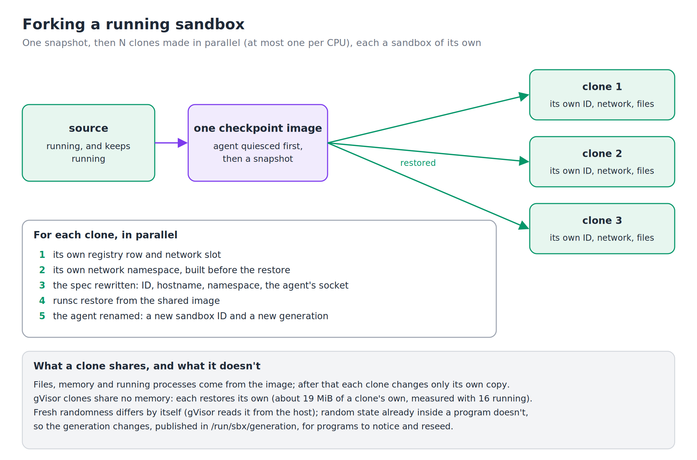
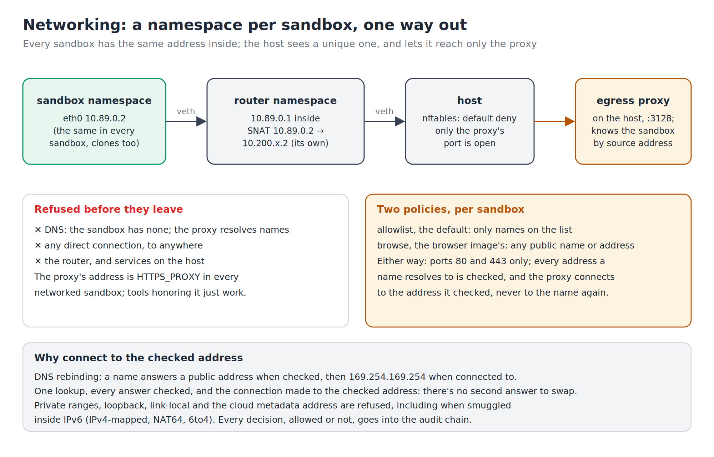
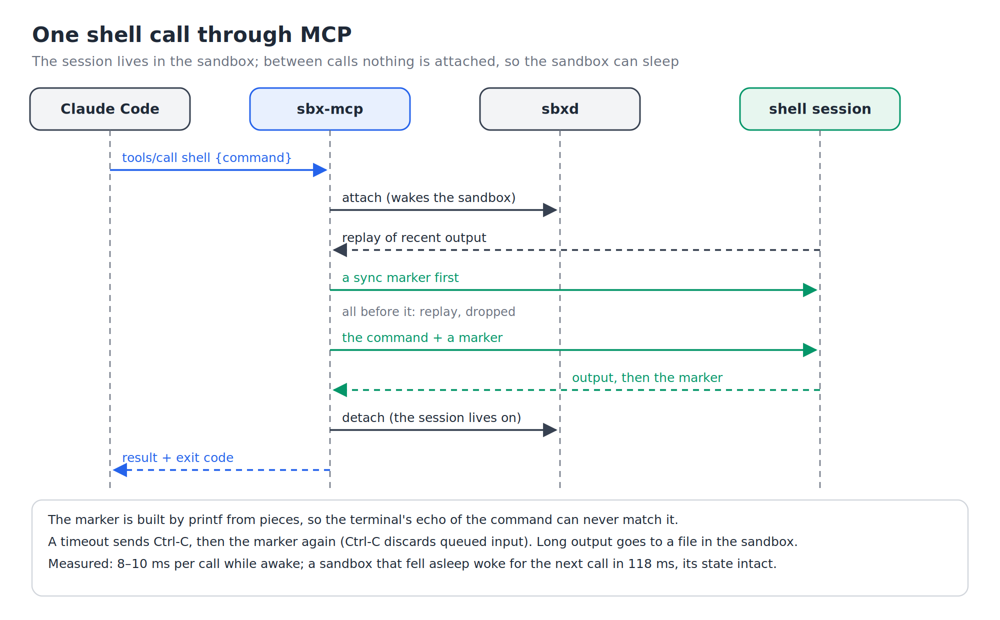

# CryoVm

A persistent, sandboxed computer for AI agents, written from scratch in Go.

Each agent gets its own isolated Linux machine, with a filesystem, terminal sessions, background
processes and a headless browser, which it drives as **MCP tools**. The machine persists: when
nobody uses it, it **checkpoints itself to S3-compatible storage** and stops costing anything but
disk; the next request **wakes it with its programs and terminals exactly as they were**. It can
**fork** while running, into copies that each carry on independently. What it builds, a person can
see: **a server it starts inside is forwarded to the host**, through the sandbox's agent rather
than its network, so it works with no network at all, and a request wakes it. A sandbox with a
network gets a namespace of its own, with all traffic forced through an egress proxy that decides,
per sandbox, what may be reached, and records every decision in a tamper-evident audit chain.

Isolation comes from **gVisor** by default, behind an interface that also takes a Firecracker
backend.

**Demo:** the sandbox driven from the terminal with `sbx`: a shell that survives disconnects, a
checkpoint and resume, a fork, the egress policy, and a web page served from inside the sandbox,
opened in a browser, that wakes the sandbox after it has fallen asleep.

[](https://youtu.be/uKVH_-AhlTw)

**Measured results** (all through the daemon's API; [method and caveats](#benchmarks))

- **A paused sandbox resumes from S3 in 86 ms** (p50), image downloaded and checksum-verified,
  within 36 ms of starting an empty one; **323 ms** when it holds 128 MiB of memory.
- **16 clones of a running sandbox in 1.08 s**, each costing about **19 MiB** of its own memory.
- **500 sandboxes running at once** on one 6-core machine (the test's cap, not the machine's limit);
  **41** with Chromium open in each.
- **A keystroke's round trip through a terminal: 1.1 ms** (p50), and 1.0 ms just after a resume.
- **Crash-safe by test, not by hope:** the daemon is stopped, as a `kill -9` would, between every
  pair of steps that save or delete a checkpoint, and twenty real `kill -9`s were run against the
  real binaries and object store. No run left a checkpoint claimed that wasn't there, or storage
  that nothing claimed.
- **342 tests** in 17 packages, under the race detector, as root and as an unprivileged user; **35
  of them run against real gVisor**. Each feature was also checked by deliberately breaking it and
  confirming a test fails.



---

**Contents:** [Quick start](#quick-start) · [Architecture](#architecture) ·
[Design decisions](#design-decisions-and-their-trade-offs) · [Testing](#testing) ·
[Benchmarks](#benchmarks) · [Interfaces](#interfaces) · [Configuration](#configuration) ·
[Repository layout](#repository-layout) · [Designed, not built](#designed-not-built) ·
[Limitations](#limitations) · [References](#references)

## Quick start

Needs a Linux host with cgroup v2, `iproute2` and `nftables`; Go 1.22 or later; gVisor's `runsc`
(tested with release-20261005.0); and an **Ubuntu 24.04 root filesystem unpacked as a directory**,
with `python3` in it, at `/mnt/sbx/rootfs/ubuntu-24.04`. (Development used the Ubuntu 24.04
squashfs image that Firecracker's CI publishes, unpacked with `unsquashfs -d`.) The daemon runs as
root; you don't.

The code lives in the repository's `CryoVm/` folder, and its programs are named `sbx`; every path
below except `docs/` is relative to that folder.

```bash
git clone https://github.com/Crpedeim/CryoVm && cd CryoVm/CryoVm
CGO_ENABLED=0 go build -o bin/sbx-agent ./cmd/sbx-agent    # static: it runs inside sandboxes
CGO_ENABLED=0 go build -o bin/sbx ./cmd/sbx
CGO_ENABLED=0 go build -o bin/sbx-mcp ./cmd/sbx-mcp
go build -o bin/sbxd ./cmd/sbxd

sudo scripts/install.sh        # sbxd as a systemd service; adds you to the sbx group
newgrp sbx                     # or log out and back in, once
```

Optional, each a one-time setup: `sudo scripts/s3-local.sh` runs a local S3 store (SeaweedFS) and
restarts `sbxd` to pause sandboxes to it; `sudo scripts/build-browser-rootfs.sh` builds the browser
image (Chromium and Playwright).

```bash
S=$(sbx create -net)                     # a sandbox with a network; prints its ID
sbx exec $S -- python3 -c 'print(6*7)'
sbx shell $S                             # an interactive shell; Ctrl+] detaches, the session lives on
sbx start $S -- sh -c 'i=0; while :; do i=$((i+1)); echo $i; sleep 1; done'
sbx start $S -- python3 -m http.server 8000   # a web server, as an agent would start one
sbx ports $S                             # what listens inside, and which process
sbx forward $S 8000                      # (a second terminal) http://127.0.0.1:8000 here, until Ctrl+C
sbx checkpoint $S                        # paused: its whole state saved, nothing running
sbx resume $S                            # the counter carries on where it was
sbx fork -count 3 $S                     # three running copies; prints their IDs
sbx audit -verify                        # check the audit chain
```

**Give an agent its own computer.** One command makes it available to Claude Code; the sandbox is
created the first time and reused after:

```bash
claude mcp add sbx -- /usr/local/bin/sbx-mcp -sandbox agent -create -image browser
```

(Without a browser image, use `-net` instead of `-image browser`.) When the agent builds something
with a web interface, its `forward_port` tool hands it a URL on your machine to give you.

To have it sleep when idle and wake when used, give the sandbox an idle timeout: create it yourself
first, and `sbx-mcp` binds to it by name (`sbx create -id agent -net -idle 15m -idle-action pause`),
or set a default for every sandbox by adding `-idle 15m` to `SBXD_FLAGS` in `/etc/sbx/sbxd.env` and
restarting `sbxd`. Without one, `sbxd`'s default is never to pause.

## Architecture

Everything runs on one host. **`sbxd`**, the daemon, owns every sandbox: it records each one in a
SQLite registry, starts and stops them through an isolation backend, saves and restores them, and
serves an HTTP API on a Unix socket. **`sbx`** is the command-line client. **`sbx-mcp`** is the
MCP server an agent talks to: it runs as the user, reaches the daemon through the socket's group,
and is bound to one sandbox for its whole session. Inside every sandbox, a **guest agent** runs as
PID 1 and does what the daemon asks.

The main parts of the system each have a diagram, at the start of the section that explains them.

### Isolation: why gVisor



gVisor runs each sandbox on the **sentry**, a kernel written in Go that runs as an ordinary process.
The workload's system calls go to the sentry, which implements them itself, with its own memory
management, process table and TCP/IP stack; only a narrow, seccomp-filtered set of calls reaches the
host's kernel. It needs no `/dev/kvm`, and checkpoints and restores whole sandboxes.

**The trade-off, plainly:** a user-space kernel is a weaker boundary than hardware virtualization,
and a much stronger one than a container. Firecracker microVMs would be stronger still. The project
started on Firecracker, but its guests crashed at boot on the development machine, a nested VM on
an AMD Zen 5 CPU, which Firecracker doesn't support. So the default became gVisor, and Firecracker
stays behind the same `Backend` interface for bare-metal hosts: its adapter boots a microVM with
its serial console and shuts it down, and everything that needs a guest agent inside it is
[designed, not built](#designed-not-built).

Each sandbox's root filesystem is a shared image, read-only, with a private layer in memory for its
writes. Its limits come from a cgroup: memory, a CPU set (assigned round-robin), and processes. Two
measured findings shaped how limits work:

- **A limit enforced on gVisor takes the whole sandbox down:** the kernel sees the sentry as one
  process. So a **memory guard** in the daemon watches each sandbox and, near 85% of its limit, has
  the agent kill the single process using the most memory, the way earlyoom or systemd-oomd act
  before the kernel's own OOM killer.
- **The process limit moved inside the sandbox**, as `RLIMIT_NPROC` applied by the agent to
  everything it starts; a fork bomb then exhausts its own sandbox and nothing else.

### The guest agent and its protocol

The guest agent is a static Go binary that runs as the sandbox's init. It owns every process the
daemon starts, reaps orphans, and publishes the sandbox's identity. The daemon reaches it over a
Unix socket shared into the sandbox, through a `Transport` interface (Firecracker's would be vsock).

The protocol is **length-prefixed JSON frames**: a 4-byte length, then one message carrying a type
and a request ID, so many requests share one connection. JSON keeps every frame readable while
debugging; the length prefix makes boundaries unambiguous. Frames are capped at 1 MiB, so a broken
or hostile peer can't make the other side allocate without bound. There are 58 message types:
exec with streamed output and exit codes; file transfers in chunks with a checksum, flow-controlled
by acknowledgements with at most 2 MiB in flight; directory listings; terminal sessions; background
processes; port tunnels; and identity.

### Terminals and background processes

**Terminal sessions** are PTYs that live in the sandbox, not in a client. A client attaches, and
when it goes away the session keeps running; any client can reattach by the session's ID, after
the recent output is replayed. Working directory, environment and running programs persist, so a
shell is a place an agent comes back to.

**Background processes** are for servers and long jobs. Each runs in its own process group with
its output in a log file inside the sandbox; logs are read from any offset, so a client can follow
along or page back through hours of output, and processes are signaled and waited on by ID.

Over HTTP, an exec's output streams as newline-delimited JSON. A shell **upgrades the connection
(HTTP 101)** and then carries the protocol's frames directly; everything that can fail is checked
before the 101, so errors still arrive as proper HTTP responses.

### Lifecycle and crash safety



Every sandbox moves through eight states, and the registry lists every legal move between them; a
transition that isn't listed is refused as a bug or a race, never silently applied.

**The daemon can crash at any moment, and sandboxes must survive it.** When `sbxd` starts, it
reconciles the registry against what's really running: sandboxes still running are **adopted**,
their agents reconnecting, not killed; a destroy that was in progress is finished; a restore that
was interrupted goes back to paused, with its image intact; a pause cut short is recognized as
complete if its image was already claimed, because the transition into checkpointing names the
image it was taking. A clean stop pauses every sandbox for the next start. The systemd unit uses
`KillMode=process`, so restarting the daemon never kills the sandboxes it adopts.

`sbxd` holds an exclusive lock on its registry and state directory: a second daemon on the same
data would reconcile the first one's live sandboxes, fail to adopt them and destroy them. It's
refused, naming the first one's PID.

### Idle pause and wake

A sandbox is **idle** when nobody has used the API for it, nothing is in flight (an attached shell,
a followed log, an open connection through the proxy), and it has used less than 0.05 CPU cores
since the last sample. That last condition matters: a twenty-minute build with nobody watching
isn't idle, and pausing it would freeze it halfway. An idle sandbox is checkpointed and stops; any
later request for it wakes it first, transparently. Concurrent requests to a sleeping sandbox wake
it exactly once.

### Snapshots and the S3 store



A checkpoint is the sandbox's whole state, its memory, processes and open files, as an image
directory written by `runsc checkpoint`. With a snapshot store, images go to S3-compatible storage
(SeaweedFS, MinIO or AWS S3), through a small S3 client with Signature Version 4 written for this
project, and the local copy can be dropped.

**One rule makes it crash-safe: the registry is the truth, so data is written before its claim, and
claims are removed before their data.** Each upload sends every file, then a manifest, last; a
checkpoint is in the store exactly when its manifest exists. A crash between any two steps can then
leave only data nothing claims, which the startup sweep removes, never a claim pointing at missing
or half-written data. A test stops the daemon between every pair of steps and checks, at that
moment, that every claim is already true.

Downloads land in a `.partial` directory, **every file checked against the manifest's SHA-256**,
and are renamed into place only when complete. The client doesn't rely on the server for
integrity: SeaweedFS accepts a body that doesn't match its signed hash, which testing showed. A
tampered manifest naming a file like `../../etc/x` is refused.

Two details came from the benchmarks:

- **A checkpoint could kill its own sandbox.** Writing the image through the page cache charged
  the cache to the sandbox's memory limit, so a sandbox holding 128 of 256 MiB was killed by the
  kernel mid-checkpoint. Images are now written and read with `O_DIRECT` for a sandbox holding more
  than 40% of its limit, where the risk is; below that, buffered I/O is safe and about 20 ms faster.
- **Images are versioned:** each browser-image build gets its own directory, and a sandbox records
  the exact version it was made with, because a paused sandbox must resume on exactly the files it
  was checkpointed with.

### Fork and clone identity



`fork` snapshots a running sandbox once, leaving it running, then restores N clones from that one
image, in parallel. Each clone gets its own registry row, network namespace, OCI spec (ID,
hostname, namespace path) and identity. Before any checkpoint, the agent lets go of its connection
(quiesces): skipping that left the source unreachable after a snapshot.

**What clones share:** files, memory and running programs come from the image, and from then on
each changes only its own copy. gVisor clones don't share memory pages; each restores its own copy,
about 19 MiB per clone in the benchmarks.

**Clone identity:** a clone starts as an exact copy of its source, including whatever randomness
was already inside running programs. Fresh reads from the random device already differ, since
gVisor draws them from the host; state already inside a program can't be reseeded from outside. So
each clone's agent takes a new sandbox ID and a new **generation**, published in
`/run/sbx/generation` and the environment of everything it starts, for programs to notice and
reseed, the idea behind VM generation IDs.

**Where fork's time goes:** each phase of a clone's creation is timed. The registry and network
phases stay near 0 ms at every N; the restore grows from 70 ms with one clone to 260 ms with 16, as
the restores share the CPUs. Making clones in parallel therefore helps little, and the limit is
gVisor's restore work, not sbx.

### Networking and egress



A sandbox created with a network gets its own network namespace, behind a small **router
namespace** of its own (one without a network has none at all). Every such sandbox, clones
included, has the same address inside, 10.89.0.2, so a restored or forked network
stack works unchanged; the router translates it to an address unique to the sandbox before traffic
reaches the host. When the router's namespace is deleted, its rules go with it: nothing about a
sandbox is left in the host's own rules.

**Default deny:** nftables rules drop everything leaving a sandbox except connections to the egress
proxy. A sandbox has no DNS and no direct route anywhere; `HTTPS_PROXY` points tools at the proxy.

**The egress proxy** is an HTTP CONNECT proxy written for this project. It knows which sandbox is
calling **only by the source address it sees**, never by anything the sandbox sends, and applies
that sandbox's policy: the **allowlist** (named hosts, ports 80 and 443), or **browse**, for
browser sandboxes (any public host or address on those ports). Either way it resolves the name
itself, checks **every** address the name resolves to against the special-purpose ranges (private,
loopback, link-local, the cloud metadata address 169.254.169.254, and IPv4 smuggled inside IPv6),
and **connects to the address it checked**, so DNS rebinding has no second answer to swap in.
Every decision, allowed or refused, goes into the audit chain.

**The audit chain** records every API call, exec, session and connection decision; each entry's
hash covers its content and the previous entry's hash, so `sbx audit -verify` finds any entry
deleted, reordered or edited.

### Port forwarding: seeing what an agent built

An agent that builds a web app starts its server inside the sandbox. `sbx forward` serves that port
on the host, the way `ssh -L` does, so a person can open it in a browser; through MCP, the
`forward_port` tool does the same and hands the agent the URL to pass on.

**It goes through the agent, not the network.** Each local connection becomes one request to the
daemon, upgraded (HTTP 101) to a raw byte stream; the daemon has the sandbox's agent connect to the
port on the sandbox's own loopback, and the bytes travel as frames over the agent's connection,
flow-controlled each way like a terminal's. So it reaches a server listening on localhost alone, as
most development servers do by default; it works in a sandbox with no network at all; and the
default-deny rules stay as they are, since nothing comes in through the network. If 127.0.0.1
refuses, the agent tries ::1 (Node may listen there alone), then any address a listening socket is
bound to.

**It's a TCP proxy, not an HTTP one,** so anything over TCP works, with TCP's half-close carried end
to end: a client can send its request, close its side, and still get the whole answer. The two
directions run independently: a server that writes while it reads is never held up by its own
output, and a tunnel nobody reads holds up only itself, never the agent's other streams.

**It counts as use.** A connection to a sleeping sandbox wakes it first, so a preview left open in a
browser still works after the sandbox has napped; an open connection keeps it awake, as an attached
shell does; and every connection goes into the audit chain, opened and closed, with its bytes each
way. On real gVisor (the integration test, run on a 4-CPU cloud VM rather than the benchmark machine
below), a page through the forward took 37 ms, and 258 ms when the request first had to wake the
sandbox and its restored server answered.

`sbx ports` lists what listens inside, from the kernel's socket tables (gVisor keeps Linux's
`/proc/net/tcp`), with the process holding each socket. A browser opening a forwarded address
before anything listens there gets a page saying so, not an empty response. A sandbox keeps the
agent it was created with, so the host checks the agent's version first: a sandbox made by an
earlier sbx says so at once, instead of leaving the request to wait.

### MCP: tools written for a model



`sbx-mcp` speaks MCP over stdio (JSON-RPC, written from the specification) and offers ten tools:
`shell`, `read_file`, `write_file`, `list_files`, `start_process`, `process_logs`,
`forward_port`, `fork`, `browse` and `sandbox_info`. **No tool takes a sandbox ID**: the session is
bound to one sandbox when it starts, so no tool can reach another.

`shell` runs commands in a **persistent** session, so `cd`, variables and activated environments
carry over. A terminal has no "command finished" signal, so each command is followed by a marker
line carrying a fresh nonce and the exit status, assembled by `printf` so the terminal's echo of the
command can never match it. A timeout interrupts with Ctrl-C, then sends the marker again, since
Ctrl-C discards queued input. Between calls the session is **detached**: an attached shell would
count as activity and keep the sandbox awake forever. Reattaching replays recent output, which a
sync marker separates from the next command's.

Results are written for a model to read. Long output keeps its beginning and end, with the full
text saved in the sandbox for `read_file` to page through. Failures explain themselves: exit codes
are decoded (127 is "command not found"; 137 says whether the memory guard did it, quoting its
numbers), network refusals are explained by the sandbox's actual policy, and `exit` in the
persistent shell says what it cost. `browse` loads a page in Chromium inside the sandbox, so the
proxy's policy applies, and returns its text and, optionally, its screenshot as an image.
`forward_port` returns a URL on the user's machine, with the same port number when it's free, that
lasts for the session; if nothing listens on the port yet, it says so and names what does.

## Design decisions and their trade-offs

| Decision | Why | What it costs |
|---|---|---|
| gVisor by default, Firecracker behind the same interface | Runs anywhere, including nested VMs; whole-sandbox checkpoint and restore | A weaker boundary than a microVM |
| A guest agent as PID 1 | The daemon controls processes, sessions and identity from inside | Every image carries the agent binary (about 3.8 MiB of each upload) |
| Sessions live in the sandbox | Survive client disconnects, pauses and daemon restarts | The agent holds scrollback for every session |
| The registry is the truth; data before claims | A crash at any point leaves nothing claimed that isn't there | The startup sweep must find and delete orphans |
| Adopt sandboxes after a daemon crash | A crash costs no sandbox its work | Reconciliation must handle every in-between state |
| User-space memory guard at 85% | Kills one process instead of the whole sandbox | A burst faster than its sampling still hits the kernel's limit |
| Same address inside every sandbox | Restored and forked network stacks work unchanged | A router namespace per sandbox to translate it |
| The proxy identifies sandboxes by source address | Nothing a sandbox sends can claim another's identity | Requires a unique outside address per sandbox |
| Check every resolved address; connect to the checked one | Defeats DNS rebinding and smuggled private addresses | The proxy does its own name resolution |
| `O_DIRECT` only above 40% of the memory limit | Prevents the checkpoint OOM where it can happen | Small checkpoints would be about 20 ms slower if always direct |
| Detach the MCP shell between calls | An agent's sandbox can still sleep | About 5 ms more per call, to reattach |
| Forward ports through the agent, not the network | Reaches servers on the sandbox's localhost; works without a network; opens nothing in the firewall | A connection carries tens of MB/s, the JSON framing's speed, not a socket's |
| SQLite `synchronous=NORMAL` | Survives any process crash; one fsync less per commit | Durability across power loss, which checkpoint images don't have either |

## Testing

From `CryoVm/`:

```bash
go test -race ./...                                                  # unit and component tests
CGO_ENABLED=0 go build -o bin/sbx-agent ./cmd/sbx-agent              # integration tests, as root:
go test -c -tags integration -o bin/daemon-it.test ./internal/daemon
sudo SBX_RUNSC="$(which runsc)" SBX_AGENT="$PWD/bin/sbx-agent" bin/daemon-it.test -test.run Integration
```

**342 tests** in 17 packages, run under the race detector and also as an unprivileged user. Most
use a stand-in backend that runs the real guest agent in-process, with real PTYs and processes, and
a stand-in `runsc` that keeps state in files and can fail on cue (a busy `state` call, a sandbox
that won't stop). An in-memory S3 server stands in for the object store, and the store's tests also
run against a real SeaweedFS when one is configured. **35 integration tests** run against real
gVisor: lifecycle, adoption after a restart, limits, the memory guard, checkpoint, idle pause and
wake, fork and clone identity, networking, default deny, the proxy, the browser, MCP, port
forwarding, and the snapshot store.

**Crash safety is tested directly.** One test stops the daemon at every point between two writes
of a checkpoint's save, upload, fetch or delete, then starts a fresh daemon on the same registry,
disk and store, and checks that every claim is true and nothing is unclaimed; it checks claims at
the moment of the crash too, before the startup sweep could repair anything. Twenty real `kill -9`s
of `sbxd` during pauses and resumes, with real binaries and SeaweedFS, found no violations.

**Every fix was checked by breaking it on purpose:** changing one line (claiming before uploading,
leaving the shell attached, skipping the stale-container cleanup) and confirming a test fails.
Some bugs hid behind tests that passed for the wrong reason: one skipped wherever a browser was
installed, one passed only because a slow process always finished first. Each test now asserts
what it was meant to, wherever it runs.

## Benchmarks

Full results, every sample's summary and the machine's conditions:
[docs/benchmarks/RESULTS.md](docs/benchmarks/RESULTS.md). Run them from `CryoVm/`, with `sbx`
installed: `go build -o bin/sbx-bench ./cmd/sbx-bench && sudo bin/sbx-bench -out bench-results`.

> **Measured on one machine**: an AMD Ryzen 5 9600X with 6 CPUs and 23 GB of memory, **itself a
> VirtualBox VM**, so gVisor ran nested; Linux 7.0, `runsc` release-20261005.0 on systrap,
> checkpoints on ext4, SeaweedFS 4.48 on the same host. The numbers show relative costs; compare
> them only with numbers from the same setup.

Cold start, pause and resume are the p50 of 20 runs after a discarded warm-up; fork, of 5 runs per
size; the terminal, of 200 keystrokes. p99s are in the full results; with 20 samples, a p99 is
simply the largest one.

| What | Result (p50) |
|---|---|
| Cold start: create → first exec | 50 ms |
| Resume from local disk, holding 0 / 64 / 128 MiB | 74 / 129 / 149 ms |
| Resume from S3, holding 0 / 64 / 128 MiB | **86** / 197 / **323** ms |
| Pause to local disk, holding 0 / 64 / 128 MiB | 68 / 144 / 157 ms |
| Pause to S3, holding 0 / 64 / 128 MiB (uploads of 5 / 72 / 136 MiB) | 116 / 363 / 523 ms |
| Fork into 1 / 2 / 4 / 8 / 16 running clones | 130 / 187 / 276 / 521 / **1,079** ms |
| Memory per clone, with 16 running | **18.6 MiB** its own (19.9 MiB PSS) |
| Sandboxes running at once | **500** idle (the cap); **41** with Chromium open (50% memory budget) |
| Terminal keystroke round trip: running / just resumed | 1.1 / 1.0 ms |
| Pause, buffered vs `O_DIRECT`, holding 0 / 64 MiB | 48 vs 70 / 120 vs 150 ms |

Resume is slower than a cold start because there's more to bring back: on gVisor there's no guest
kernel to boot, so an empty sandbox starts fast, and resume's value is that everything returns. The
density test stops at half the memory available, since filling a host for real could take down
everything else on it; extrapolated by memory alone, the machine would hold about 1,500 idle
sandboxes or 80 with Chromium.

## Interfaces

**The CLI** (`sbx`): `create`, `ls`, `info`, `stats`, `events`, `exec`, `put`, `get`, `files`,
`shell`, `sessions`, `kill-session`, `start`, `ps`, `logs`, `signal`, `wait`, `rmproc`, `ports`,
`forward`, `extend`, `checkpoint`, `checkpoints`, `resume`, `images`, `fork`, `audit`, `rm` and
`run`. Run `sbx` alone for each one's flags.

**The HTTP API**, on `/run/sbx/sbxd.sock`:

| Request | Does |
|---|---|
| `POST /v1/sandboxes` · `GET /v1/sandboxes` · `GET`, `PATCH`, `DELETE /v1/sandboxes/{id}` | create, list, inspect, extend, destroy |
| `POST /v1/sandboxes/{id}/exec` | run a command; output streams as newline-delimited JSON |
| `PUT`, `GET /v1/sandboxes/{id}/files` · `GET .../ls` · `GET .../stat` | upload, download, list, describe |
| `POST /v1/sandboxes/{id}/shell` · `GET .../sessions` · `DELETE .../sessions/{sid}` | open or attach a terminal (HTTP 101), list, end |
| `POST`, `GET /v1/sandboxes/{id}/processes` and `.../processes/{proc}`, `/signal`, `/wait`, `/logs` | background processes |
| `GET /v1/sandboxes/{id}/ports` · `POST .../ports/{port}/connect` | what listens inside; a connection to a port (HTTP 101, then the raw TCP stream) |
| `POST`, `GET /v1/sandboxes/{id}/checkpoints` · `POST .../resume` · `POST .../fork` | checkpoint, list, resume, fork |
| `GET /v1/sandboxes/{id}/stats` · `GET .../events` | resource use and limits; state history |
| `GET /v1/audit` · `GET /v1/audit/verify` · `GET /v1/images` · `GET /v1/health` | the audit chain, its check, image versions, health |

**MCP** (`sbx-mcp`): `-sandbox NAME` binds the session; `-create` makes the sandbox if it doesn't
exist, with `-image`, `-net` and `-mem`. `scripts/mcp-try.py` calls the tools by hand, to see what
an agent sees.

## Configuration

`sbxd` flags (the systemd unit sets the first four; `/etc/sbx/sbxd.env` can add more):

| Flag | Default | Meaning |
|---|---|---|
| `-rootfs` | | the default root filesystem for new sandboxes |
| `-agent` | | the static `sbx-agent` binary |
| `-runsc` | `runsc` | gVisor's runtime |
| `-sock-group` | owner only | a group whose members may use the API socket |
| `-sock` | `/run/sbx/sbxd.sock` | the API socket |
| `-db`, `-state`, `-checkpoints` | under `/var/lib/sbx` | the registry, runtime state, checkpoint images |
| `-vcpus`, `-mem`, `-pids` | 1, 256 MiB, 1024 | defaults for each sandbox |
| `-idle`, `-idle-action` | none, pause | idle timeout, and what it does |
| `-ttl` | none | a maximum lifetime |
| `-on-stop` | pause | what a clean stop does with running sandboxes: pause, leave, destroy |
| `-egress` | deny | `deny`: only the proxy; `open`, for debugging |
| `-allow` | `pypi.org,files.pythonhosted.org` | the proxy's allowlist |
| `-proxy-port` | 3128 | the proxy's port on the host |
| `-browser-rootfs` | `/mnt/sbx/rootfs/browser-current` | the browser image |
| `-store`, `-store-bucket`, `-store-evict` | none, `sbx`, false | the S3 snapshot store; credentials from the environment |
| `-checkpoint-io` | auto | `O_DIRECT` above 40% of a sandbox's limit; or `direct`, `buffered` |
| `-backend`, `-platform` | gvisor, runsc's default (systrap) | the isolation backend and gVisor's platform |

## Repository layout

Paths are inside `CryoVm/`, except `docs/`, at the repository's root.

| Path | What it is |
|---|---|
| `cmd/sbxd` | the daemon |
| `cmd/sbx` | the command-line client |
| `cmd/sbx-mcp` | the MCP server |
| `cmd/sbx-agent` | the guest agent binary |
| `cmd/sbx-bench` | the benchmark suite |
| `cmd/sbx-boot` | boots one Firecracker microVM with its console attached |
| `internal/daemon` | lifecycle, reconciliation, idle, fork, snapshots, network and proxy wiring, port forwarding, the HTTP API |
| `internal/registry` | the SQLite registry, the state machine, the audit chain |
| `internal/sandbox` | the backend interface; `gvisor` and `firecracker` implement it |
| `internal/guest` | the guest agent: exec, files, sessions, processes, port tunnels, identity |
| `internal/agent`, `internal/agentproto` | the daemon's side of the agent connection, and the wire format |
| `internal/netns`, `internal/proxy` | per-sandbox networking, and the egress proxy |
| `internal/store`, `internal/s3` | the snapshot store, and the S3 client |
| `internal/mcp` | the MCP protocol and tools |
| `internal/client`, `internal/api` | the Go client and the shared types |
| `internal/vm`, `internal/fc` | Firecracker's process and API |
| `scripts/` | install, local S3, image builds, `mcp-try.py` |
| `docs/` | the diagrams, and the benchmark results |

## Designed, not built

- **Firecracker parity on bare metal.** The agent over vsock, the jailer for limits, and microVM
  snapshots, behind the same `Backend` interface, for hosts where hardware isolation is required.
  With it, lazy restore through userfaultfd, so resume time stops growing with memory size, and
  clones that share memory pages until they write.
- **Incremental and content-addressed checkpoints.** Write only what changed since the last
  checkpoint, and store files by their hash, so the agent binary every image carries is uploaded
  once rather than with every checkpoint.
- **Full GUI computer use:** a virtual display with screenshot, mouse and keyboard tools, beyond the
  headless browser.
- **Secret injection at the proxy:** API keys attached to outbound requests, never present inside
  the sandbox.
- **Approval gates:** high-risk actions paused until a person approves.
- **Multi-agent sessions:** agent identity, per-agent policy including per-sandbox allowlists, and
  shared state between agents.
- **Multi-host scheduling:** placement by capacity and checkpoint locality, with the registry's
  reconciliation extended across machines.

## Limitations

- **One host.** sbx is a sandbox runtime, not an orchestrator.
- **gVisor's boundary is weaker than a microVM's,** as described above.
- **Fork is bounded by gVisor's restore work:** clones are made in parallel, but restores share the
  CPUs.
- **`auto` checkpoint I/O falls back to `O_DIRECT` after a resume:** a restored sandbox's memory use
  isn't read yet, so the safe choice is taken, costing small sandboxes about 20 ms per pause.
- **A crash in one narrow window loses a sandbox:** after a checkpoint has stopped it and before
  its image is claimed. The image can't be proven complete, so it's swept rather than trusted.
- **No durability across power loss:** checkpoint images aren't fsynced, and the registry commits
  without a sync per write.
- **Access control is the Unix socket's permissions.** The one parameter that reaches the host, a
  sandbox's root filesystem, is reserved for the daemon's own user. There's no TLS or remote API.
- **A forwarded port is open to everyone on the host,** as with `ssh -L`: `sbx forward` and
  `forward_port` listen on 127.0.0.1, which any local user can connect to, not on the socket whose
  permissions guard the API. `sbx forward -addr 0.0.0.0` opens it to the network as well.
- **Benchmarked inside a VM,** on one machine.

## References

- The gVisor documentation: architecture, platforms and checkpoint/restore. https://gvisor.dev/docs/
- Agache et al., *Firecracker: Lightweight Virtualization for Serverless Applications*, NSDI 2020.
- The Open Container Initiative's runtime specification. https://github.com/opencontainers/runtime-spec
- The Model Context Protocol specification. https://modelcontextprotocol.io/specification
- Anthropic, *Writing effective tools for agents*. https://www.anthropic.com/engineering/writing-tools-for-agents
- OWASP, *Server-Side Request Forgery Prevention Cheat Sheet*.
- Microsoft, *Virtual machine generation identifier* (the idea behind clone generations).
- SQLite, *Write-Ahead Logging*, on `synchronous=NORMAL`. https://www.sqlite.org/wal.html
